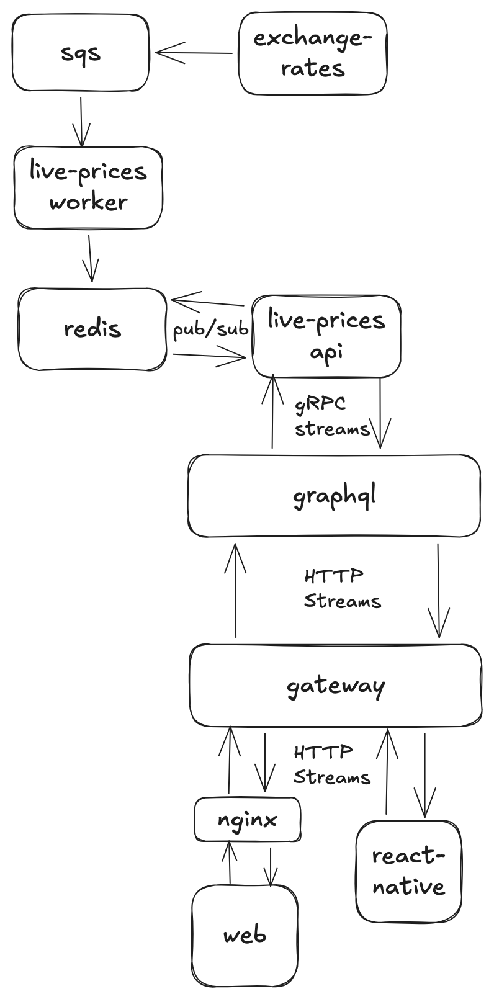

# HTTP streams vs. WebSockets

_The foundational decision to standardize GraphQL live data at Coinbase on HTTP streams (SSE over HTTP/2) rather than WebSockets, overcoming early skepticism about HTTP/2's ability to scale._

## Intro

Before around 2018, the Coinbase app was simple. It supported only three assets (BTC, ETH and LTC) and had far fewer users. Then Coinbase adopted a strategy of becoming the "Amazon of crypto", which was very successful in growing the business. By 2021, though, the infrastructure hadn't caught up with all the new assets and users. The original live data system was designed for thousands of concurrent connections on a handful of asset pairs, not hundreds of thousands of connections across thousands of asset pairs.

That lack of infrastructure and guidance meant live data was barely used in the consumer app, essentially just for prices and balances. Prices ran over a WebSockets service that, without a distributed cache, only updated every 3-5 seconds, and WebSockets had a history of leaked connections and a buggy client reconnect loop. Pro Trading used a separate system built on HTTP streams.

At the same time, GraphQL was rapidly growing in adoption and mindshare, so a live data abstraction in GraphQL would let Coinbase bring live data to many existing experiences and build entirely new ones. Whatever protocol we chose would become the foundation every live feature was built on.

I was on the team that owned GraphQL, and was the directly responsible individual for the frontend data layer library. I worked closely with product teams on the initial migration to GraphQL, and as it progressed, we saw an opportunity to take ownership of the live data story, so I took it on. I built the performance comparison, wrote the recommendation, and led the team that shipped the first version and migrated prices. It became the foundation and by the time I left there were 75+ subscriptions in the schema.

## Problem

The Data Layer team needed to decide which protocol to use for the GraphQL live data system. At the time, Coinbase had two live data systems used in the frontends:

1. WebSockets, used for prices
2. HTTP streams, used for the Pro Trading interface

### GraphQL live data systems

In GraphQL there are two ways live data is used:

| Operation        | Description                                                                                                                                |
| ---------------- | ------------------------------------------------------------------------------------------------------------------------------------------ |
| Subscriptions    | The typical live data operation, where a stream of events updates the cache on the client                                                  |
| Deferred queries | A performance optimization directive used to stream slow portions of a query to the client after an initial payload of fast fields is sent |

We were primarily focused on subscriptions at this point, but were conscious that we would someday need to extend our systems to support deferred queries.

## Requirements

- **One-way delivery.** Subscriptions only push events from server to client, so the bidirectional channel WebSockets provide gave us no advantage.
- **Future support for deferred queries** (see [Frontend architecture concerns](#frontend-architecture-concerns)).
- **Scale.** We would need to support hundreds of thousands of concurrent connections to handle features such as live prices.
- **Platforms.** React Native and web.
- **Latency.** Startup time was not a concern, but improving event latency would be a huge win.
- **Reconnects.** We needed a resilient reconnect loop with clear triggers and error states.

### What "HTTP streams" means here

Server-sent events (SSE) over HTTP/2, with each subscription on its own HTTP/2 stream. HTTP/2 multiplexes those streams over a single TCP connection, so we didn't need our own multiplexing protocol on top.

## Considerations

1. Operational experience
2. Platform support
3. Performance
4. Frontend architecture concerns

### Operational experience

At the start of this conversation, we spent some time discussing the options with senior ICs in the platform org, specifically members of the Routing team. They were of the opinion that WebSockets were a relative pain to support compared to HTTP streams.

The issue was that WebSocket connections had poor graceful close behavior, which had resulted in connections leaking in the past.

Similarly, on the frontend we knew that WebSocket status codes were difficult to debug, and that behaviors like the reconnect loop were buggy.

Based on operational experience, HTTP streams were clearly the preferred option.

### Platform support

At the time, React Native did not fully implement the fetch streaming APIs. There was open source work on polyfilling them, but our initial tests showed that these projects were incomplete and we'd have to, at a minimum, patch them.

WebSockets, by comparison, had much more complete support in React Native.

WebSockets were the path of least resistance to providing React Native support.

We also had to address early skepticism about whether HTTP could scale for live data. A common assumption was that a client could only have a small number of HTTP connections open at once, which is a holdover from HTTP/1.1, where browsers allow about 6 connections per domain. With HTTP/2, many streams share a single connection. Our investigation showed that limits did still exist on some platforms. On React Native, iOS's networking layer has a fixed HTTP connection limit (~60 in our testing), while Android's is configurable. Even the iOS limit was more than sufficient for our needs.

### Performance

I built a small suite of performance tests to determine if there was a major difference between the protocols. We found that:

1. Cold start time was basically the same, with HTTP having a slight edge (likely because WebSockets have to go through an upgrade handshake).
2. HTTP has a small overhead for each new subscription, since each one is a new request on its own HTTP/2 stream, even though all the streams share a single TCP connection.
3. WebSockets have no built-in multiplexing, so sharing one socket across subscriptions requires an application-level protocol to route messages. That adds runtime overhead on the client, which could be a problem on low-end devices.

The raw performance differences were tiny, and our opinion was that network instability would become a bottleneck well before the protocol did.

### Frontend architecture concerns

Coinbase's frontend data layer library was built on a fetch stack, so it was limited to HTTP use cases. It would have been possible to support WebSockets separately, but that would likely have meant splitting the library into separate unary and streaming parts.

As we looked to our second live data use case, deferred queries, we realized that this separation between unary and streaming would be untenable. How would we make the existing unary fetch middleware support both unary and streaming?

We didn't know the answer for sure yet, but it was obvious that an abstraction that only needed to support a single protocol, HTTP, would be a lot easier to design.

For this consideration, HTTP streams were the clear choice.

### Summary

| Consideration                  | Favored      | Why                                                                |
| ------------------------------ | ------------ | ------------------------------------------------------------------ |
| Operational experience         | HTTP streams | WebSockets had leaked connections and a buggy reconnect loop       |
| Platform support               | WebSockets   | React Native's fetch streaming support was incomplete              |
| Performance                    | Neither      | Differences were tiny; network instability would bottleneck first  |
| Frontend architecture concerns | HTTP streams | One protocol lets a single fetch stack support unary and streaming |

## Decision and first use cases

In the end, we decided that picking HTTP streams and solving the platform problems was the best decision.

- I wrote a document describing our investigation and recommending HTTP streams
- To solve React Native support, we patched the open source fetch streaming polyfill and contributed our changes upstream
- I led a small team to build the initial implementation and migrate prices to GraphQL subscriptions by launching a new live-prices service

## Frontend architecture

Unary queries and subscriptions share the same pipeline. Both go through `fetch`, and the response is wrapped in a `ReReadableResponse`. Unary responses are parsed with `json()`, and SSE responses with `parseSseStream()`. Both then pass through the same middleware (authorization, retries, observability and more). Unary responses resolve a promise, while each subscription event is emitted on a Relay observable, and both update the UI.

Because there was only one protocol, every middleware works for both unary and streaming responses. This is the abstraction that later let deferred queries reuse the same path with minimal changes.

## Backend architecture

Exchange rates flow from the exchange-rates service through SQS to a live-prices worker, which writes them to Redis. The live-prices API subscribes through Redis pub/sub and streams updates to the GraphQL service over gRPC streams. From there, updates reach clients over HTTP streams through the gateway, with web traffic passing through nginx.

### Why a new service

The exchange-rates service focused on sourcing price data and publishing it for other services to consume. Serving that data to users was the job of the existing WebSockets service for prices. The problem was that service's implementation: without a distributed cache, it had high latency between price updates (3-5s) and put extra load on exchange-rates.

The new live-prices service was designed specifically to serve user traffic at scale:

- A distributed cache in Redis, with a TTL cache policy
- Redis pub/sub to push updates to live-prices API instances
- Performance optimizations, including connection dedupe and using inverse currency pairs to hydrate the cache

## Outcomes

- Shipped version 1 of GraphQL subscriptions
- Launched the live-prices service and shifted pricing traffic to GraphQL
- Price updates went from every 3-5s to under 1s
- Scaled to ~500k concurrent connections, which helped infra reach its load test goals
- HTTP's simpler, well-defined failure modes let us build a more resilient reconnect loop, which improved client connectivity metrics
- Removed WebSockets from the client architecture
- GraphQL subscriptions enabled dozens of live data use cases in the first year alone
- `@defer` was implemented later, when GraphQL federation landed, and the frontend architecture extended to it with minimal changes
- By the time I left, `@defer` was used on basically every high priority flow to reduce latency
- More recently, the Wallet team used GraphQL subscriptions for the Base app rebuild
- By the time I left, the schema had 75+ subscriptions, covering use cases such as prices, balances, trading, AI, internal tools and more

## Downsides

- **Extra platform work.** React Native support depended on patching an open source fetch streaming polyfill. We contributed the changes upstream, but it was work WebSockets wouldn't have needed.
- **Per-subscription overhead.** Each subscription is a new HTTP request on its own stream, which costs slightly more than sending a message over an already open WebSocket.
- **Head-of-line blocking, shared by both options.** HTTP/2 carries every stream over one TCP connection, so on a lossy mobile network a single lost packet stalls every subscription until it's retransmitted. However, multiplexing subscriptions over a single WebSocket has the same problem. HTTP/3, which runs over QUIC and recovers lost packets per stream, would remove the TCP-level problem.
