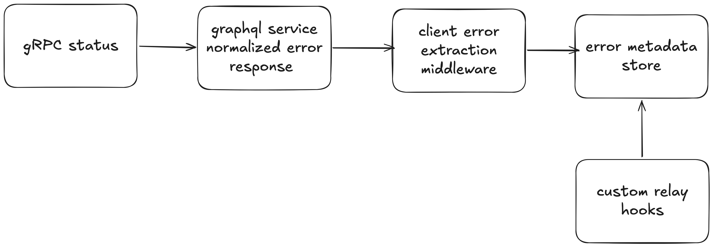
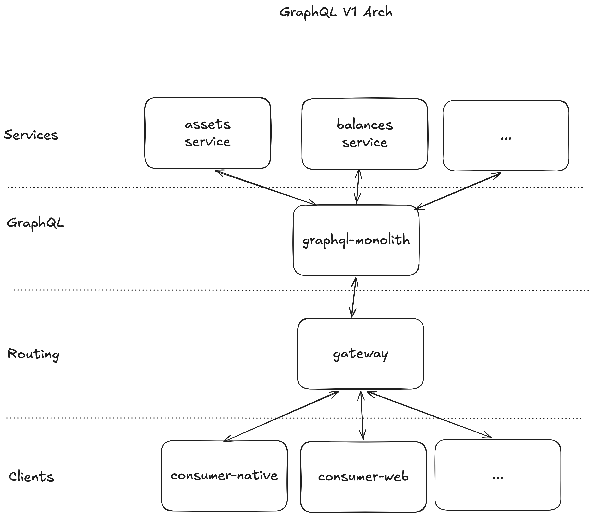

# Zero Balance Problem

## Intro

The zero balance problem is a classic Coinbase problem from the early years of the GraphQL system. It had existed in many forms, but it started showing up more as the migration to GraphQL progressed. After a high profile incident involving the primary balance on the homepage, we took a more active role in working with product teams to solve it.

## Problem

When the balance service failed, our nullable GraphQL schema returned a null balance, and client code defaulted that null to zero. Users saw a $0 balance.

```tsx
const data = useFragment(graphql`...`, ref);
const balance = data.balance ?? 0;
//
<PrimaryBalance balance={balance} />;
```

Our initial investigation found three things that made this more than a one-off bug:

| Finding    | Detail                                                                                                                                                                                       |
| ---------- | -------------------------------------------------------------------------------------------------------------------------------------------------------------------------------------------- |
| Widespread | Hundreds of places across frontend had this sort of fallback.                                                                                                                                |
| Frequent   | The balance service had a small but steady error rate. We didn't have observability into this exact client behavior, but from client RPS and service error rates we estimated it hit thousands of users every day. |
| Ephemeral  | Often the $0 only flashed for an instant. Balances update live via GraphQL subscriptions, so the initial query would fail but the subscription would eventually kick in and succeed.        |

That last finding ends up shaping the UX (see [Live data and staleness](#live-data-and-staleness)).

## Scope

We needed to answer three questions:

1. What should the UX be when a balance is missing? ([Expected UX](#expected-ux))
2. What's technically blocking that UX? ([Technical blockers](#technical-blockers))
3. How do we stop the problem from coming back? ([Preventing regressions](#preventing-regressions))

The big constraint was migration cost. There was a lot of existing code, with a decent amount of variation in the GraphQL schema and error states it used. Any solution that required a migration would be a tall order.

## Expected UX

Any solution had to meet three requirements:

| Requirement             | Why                                                                                  | Rules out                                  |
| ----------------------- | ------------------------------------------------------------------------------------ | ------------------------------------------ |
| Careful error messaging | Server-created or unlocalized error messages don't help users                        | Rendering the error message directly       |
| Partial rendering       | In GraphQL architecture, a screen should still render when some of its data is missing | Failing the whole screen over one field  |
| Live data               | Balances update live, so a value can be up to date, stale, or being updated          | Treating a failed query as a final state   |

Partial rendering creates a hard question for critical UI like the primary balance: what do we render when the balance is missing or errored?

## Finding an alternative

### Existing error handling

Our existing error handling best practices gave teams two options, and neither worked here:

| Option        | How it works                                                   | Why it falls short                                                                 |
| ------------- | -------------------------------------------------------------- | ---------------------------------------------------------------------------------- |
| Fallback      | Check if a field is present, and render a fallback or nothing  | Can't tell an error apart from an organically empty balance. This is how `?? 0` happened |
| Custom schema | Model organic null and error states explicitly in the schema   | A breaking change that requires a v2 field and a migration                         |

Here's what the custom schema option looks like in practice:

```graphql
type Query {
  primaryBalanceV2: BalanceResult
}

union BalanceResult = Balance | ServiceError | GenericError
```

Any schema migration comes at significant cost in staffing hours, trust and morale, and many migrations that start are never completed. No one is excited about making a v2 field or modeling errors this way unless the data model is truly complex.

### Using error metadata

We needed to tell "null because of an error" apart from "organically null" without changing the schema. The GraphQL response already contains that information: each error includes the path of the field it affected.

```js
{
    data: {
        primaryBalance: {
            balance: null
        },
        topAssets: [...]
    },
    errors: [{ path: ['primaryBalance', 'balance'], message: '...' }]
}
```

If the client could read this metadata, a null field with a matching error is an error, and a null field without one is organically empty. Here's what that API could look like:

```tsx
const [getBalanceError, data] = useFragmentWithError(graphql`...`, ref);

const balanceError = getBalanceError("balance");

if (data.balance == null && balanceError != null) {
  return <BalanceError />;
}
if (data.balance == null) {
  return <DepositFundsCTA />;
}
return <PrimaryBalance balance={data.balance} />;
```

The key decision was to build on metadata the response already contained instead of changing the schema, so adopting it didn't require a migration.

### Expanding the API

Knowing _that_ a field errored wasn't always enough. In some cases teams needed to know _why_. While investigating existing patterns, we found a lot of repeated schema for handling errors. Some of it modeled errors specific to its domain, but much of it covered the same common cases (service errors, connectivity issues, authorization), and many resolvers were directly mapping gRPC error codes into GraphQL error types.

So we moved that mapping into the GraphQL service's network layer. Errors automatically get a normalized error code based on the upstream gRPC response, and there are methods for setting codes manually in edge cases where there's no direct mapping. On the client, developers read the code for their fragment or field and render an appropriate localized experience:

```tsx
const [getBalanceError, data] = useFragmentWithError(graphql`...`, ref);

const balanceError = getBalanceError("balance");

if (data.balance == null && balanceError != null) {
  switch (balanceError.code) {
    case "SERVER_ERROR":
      // ...
      break;
    case "AUTHENTICATION_ERROR":
      // ...
      break;
  }
}
```

The key decision was to normalize error codes once, in the GraphQL service, instead of in each resolver's schema. Teams got explicit error states without creating v2 resolvers or migrating schema.

### Live data and staleness

Error metadata tells us _why_ a balance is missing, but on its own it would have made the UX worse. Remember that most zero balances were ephemeral: the initial query failed, but the subscription recovered a moment later. If we showed an error every time we saw error metadata, we'd just replace a flash of $0 with a flash of an error message.

So the balance UX combines two signals: the error metadata, and how long it's been since we last received a good balance update.

| Balance | Error metadata | Last good update        | UX                                     |
| ------- | -------------- | ----------------------- | -------------------------------------- |
| present | –              | recent                  | Balance                                |
| present | –              | over `<N>s` ago (stale) | Balance faded out with a shimmer       |
| missing | yes            | under 60s               | Shimmer placeholder, expect a recovery |
| missing | yes            | none in 60s             | Error state, message chosen by code    |
| missing | none           | –                       | Deposit funds CTA (organically empty)  |

The key decision was to only escalate to an error after 60s without a balance update. Before that, we assume the subscription will fix it, and we show the user that the value is updating instead of telling them something is wrong. When an update arrives, the balance is fresh again and the error no longer matters.

This logic is subtle enough that we didn't want hundreds of call sites reimplementing it, which is part of why it ended up in the design system's balance components (see [Preventing regressions](#preventing-regressions)).

## Technical blockers

Relay doesn't give components access to error metadata. In theory that makes sense, since the metadata is meant for debugging, not rendering. In practice it left a hole in Relay's error handling, which more recent versions have started to address. To use the metadata, we had to wire it from the network response to the UI ourselves.

Extracting the errors was straightforward: a network middleware indexes each response's errors in a new `ErrorMetadataStore` on our customized `GraphqlEnvironment`.

Reading them from a fragment was the real challenge. The network response identifies errors by query name and path from the root, but a fragment read only knows its fragment name and cache key, not its path. So we work from the other direction. For each error, we walk the Relay store from the root along the error path. If the walk lands on the fragment's record, that error belongs to the fragment.

### New data flow

End to end, the new data flow is:

1. The GraphQL service maps the upstream gRPC status to a normalized error code in the error metadata.
2. A client middleware extracts the errors from each response.
3. The error metadata store holds them, indexed by query.
4. `useFragmentWithError` reads from the store to decide which UX to present.



## Preventing regressions

The new APIs, documentation and training gave developers the tools to avoid this problem, but they didn't address the systemic problem already in the codebase. Two more layers did:

| Layer                            | What it does                                                                                                                 |
| -------------------------------- | ---------------------------------------------------------------------------------------------------------------------------- |
| Lint rules                       | Block nullish coalescing to zero, and detect existing violations to remove                                                   |
| Design system balance components | Built with the design system team. Encapsulate the logic for showing balances, stale states and error states, so product teams don't reimplement it |

## Outcomes

The deliverables were:

1. A new hooks API for reading error metadata
2. New lint rules that disallow nullish coercion to zero
3. New design system components for displaying balances, stale balances and errors
4. Documentation and training materials

We systematically eliminated the zero balance by removing the nullish coalescing violations the lint rule detected, and by migrating surfaces to the new design system components. We verified this through a reduction in incidents and CX tickets. There wasn't a straightforward way to detect the problem through client observability, so we relied on these proxy metrics.

Because the new APIs covered most error handling cases, schema design for new use cases also got simpler.

## Appendix

### HomeScreenQuery

```graphql
query HomeScreenQuery {
  primaryBalance {
    currency
    balance
  }
  topAssets(first: 3) {
    asset {
      ticker
      price
    }
  }
  # more below the fold content
}
```

### GraphQL architecture

The GraphQL service sits between the clients and upstream services. The client loads all the data for a screen in a single query, and the GraphQL service makes the requests to upstream services and stitches the responses together.



On the client, Relay provides an in-memory normalized cache, which maps each Relay cache key to a record. The keys look something like this:

```ts
// when a record has an explicit `id` field
"Account:12345";
// when a record does not have an id the key is built from its parent key, field name, and arguments
"client:root:primaryBalance";
"client:root:topAssets(first:3)";
```

### Errors and nulls

What happens to `HomeScreenQuery` when the balance service is down? In GraphQL, a response with errors is still a 200, and the service resolves as much data as possible. What the client gets back depends on the schema's nullability.

With required types:

```graphql
type Query {
  primaryBalance: Balance!
  topAssets(first: Int): [Asset!]!
}

type Balance {
  currency: String!
  balance: String!
}
```

```js
{
    data: null,
    errors: [{ path: ['primaryBalance', 'balance'], message: '...' }]
}
```

With nullable types:

```graphql
type Query {
  primaryBalance: Balance
  topAssets(first: Int): [Asset]
}

type Balance {
  currency: String
  balance: String
}
```

```js
{
    data: {
        primaryBalance: {
            balance: null
        },
        topAssets: [...]
    },
    errors: [{ path: ['primaryBalance', 'balance'], message: '...' }]
}
```

| Schema   | When the balance service is down                                                                 | Result                          |
| -------- | ------------------------------------------------------------------------------------------------ | ------------------------------- |
| Required | `balance` and `primaryBalance` can't be null, so the null bubbles up to the root                  | `data: null`, `topAssets` is clobbered |
| Nullable | The null stops at `balance`                                                                       | Everything else still renders   |

We called this concept "nullable schema", and it ends up being an axiom of GraphQL system design: it lets as much of the UI update as possible, and prevents individual services from breaking the whole response.

### Technical implementation

#### Extracting errors

The first part is extracting error metadata from the response and indexing it. We create a new `ErrorMetadataStore` and attach it to our customized `GraphqlEnvironment` class:

```ts
class ErrorMetadataStore {
  // Map of query name => response errors
  cache = new Map<string, GraphqlResponseError[]>();

  extractErrorsFromResponse(json) {
    // operationName is a custom extension added by our GraphQL service
    const operationName = json.extensions.operationName;
    const errors = json.errors;
    if (errors) {
      this.cache.set(operationName, errors);
    } else {
      // cleanup
      this.cache.delete(operationName);
    }
  }
}

class GraphqlEnvironment {
  errorMetadataStore = new ErrorMetadataStore();
}
```

Then we integrate the store into the network layer with a middleware:

```ts
const extractErrors = (graphqlEnv) => (next) => async (url, init) => {
  const response = await next(url, init);
  // Clone so the body can still be read by Relay
  const json = await response.clone().json();
  graphqlEnv.errorMetadataStore.extractErrorsFromResponse(json);
  return response;
};
```

#### Matching errors to fragments

Relay has two strategies for creating cache keys:

```
// Cache key structure
<recordId> // 47ac10b-58cc-4372-a567-0e02b2c3d479
<parentRecordId>:<fieldKey>:<indexKey> // 47ac10b-58cc-4372-a567-0e02b2c3d479:foo:bar(first:10):2:baz
```

When `useFragment` is called, we only have the fragment's cache key, not its path. To find its errors, we walk the Relay store along each error path and check which record it lands on:

```ts
class ErrorMetadataStore {
  constructor(relayStore) {
    this.relayStore = relayStore;
  }

  cache = new Map<string, GraphqlResponseError[]>();

  extractErrorsFromResponse(json) { ... }

  findErrorMetadata(queryName, fragmentId, fieldPath) {
    const fieldSegments = fieldPath.split(".");
    const errors = this.cache.get(queryName) ?? [];
    for (const err of errors) {
      // The error path ends with the errored field, everything before it
      // leads to the record that owns that field
      const erroredField = err.path.slice(-fieldSegments.length).join(".");
      if (erroredField !== fieldPath) {
        continue;
      }
      // Walk the Relay store from the root along the error path to find
      // the owning record's cache key
      let recordId = "client:root";
      for (const segment of err.path.slice(0, -fieldSegments.length)) {
        recordId = getLinkedRecordId(this.relayStore, recordId, segment);
        if (recordId == null) {
          break;
        }
      }
      if (recordId === fragmentId) {
        return err;
      }
    }
    return null;
  }
}
```

The hook wraps `useFragment` and exposes the lookup:

```tsx
function useFragmentWithError(fragment, ref) {
  const data = useFragment(fragment, ref);
  const env = useGraphqlEnvironment();
  // Relay internals: the owning query's name and the fragment's record id
  const queryName = ref.__fragmentOwner.node.params.name;
  const fragmentId = ref.__id;
  // Reset lookups whenever the fragment data changes so errors don't
  // outlive a refetch or subscription update
  const errorIndex = useMemo(
    () => new Map<string, GraphqlResponseError | null>(),
    [data],
  );
  const getError = (path: string) => {
    if (!errorIndex.has(path)) {
      errorIndex.set(
        path,
        env.errorMetadataStore.findErrorMetadata(queryName, fragmentId, path),
      );
    }
    return errorIndex.get(path);
  };
  return [getError, data] as const;
}
```

### Edge cases

`findErrorMetadata` gets complicated fast, and it took significant investigation and a suite of unit tests to validate. Open edge cases include:

- Fields with arguments
- Aliased fields
- List fields
- The same query in flight with different variables, since errors are keyed by query name
